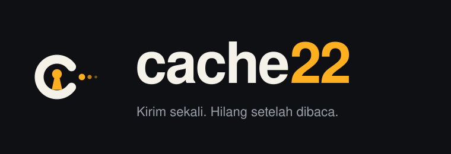

<p align="center">
  <picture>
    <source media="(prefers-color-scheme: dark)" srcset="assets/logo.svg">
    <source media="(prefers-color-scheme: light)" srcset="assets/logo-on-light.svg">
    
  </picture>
</p>

<p align="center">
  <a href="https://github.com/nekonaru/cache22/actions/workflows/ci.yml"></a>
  <a href="LICENSE"></a>
  
</p>

# Cache22

**Kirim sekali. Hilang setelah dibaca.** / **Send once. Gone after reading.**

Cache22 adalah layanan berbagi rahasia sekali baca. Kamu menempel teks atau file kecil, mendapat satu link unik, dan begitu penerima membukanya, data dihapus permanen dari server. Enkripsi dilakukan di browser (zero-knowledge): kunci hanya ada di fragmen URL dan server hanya menyimpan ciphertext.

[`README.md`](README.md) (English) · `README.id.md` (Indonesia)

---

## Kenapa

Mengirim password lewat chat berarti ia hidup selamanya di riwayat, backup, dan notifikasi. Cache22 membuat rahasia itu menghancurkan dirinya sendiri:

- **Zero-knowledge** — enkripsi di sisi klien (AES-256-GCM via Web Crypto). Kuncinya ada di fragmen URL (`#…`), yang tidak pernah dikirim browser ke server.
- **Terbakar setelah dibaca** — proses baca bersifat atomik: sekali ditampilkan, rahasia lenyap. Dua pembaca bersamaan tidak bisa sama-sama berhasil.
- **Aman dari pratinjau link** — aplikasi chat yang membuka link otomatis hanya melihat halaman HTML (dekripsi butuh fragmen **dan** tombol “Tampilkan rahasia”).
- **Kegagalan seragam** — “tidak ada / sudah dibaca / kedaluwarsa” semuanya mengembalikan `404 {"error":"not_found"}` yang byte-nya identik, jadi ID tidak bisa ditebak lewat status.
- **Satu binary statis** — hanya Go standard library. `web/index.html` di-embed dengan `go:embed`.

## Fitur

| | |
| --- | --- |
| Buat drop teks (≤ 64 KB) dan file (≤ 2 MB) | ✅ |
| TTL: 10 menit / 1 jam / 24 jam / 7 hari | ✅ |
| Maksimal dibuka: 1 (bawaan) hingga 10 | ✅ |
| Enkripsi client-side AES-256-GCM, kunci di fragmen URL | ✅ |
| Kunci link dengan passphrase (PBKDF2-HMAC-SHA256, 600.000 iterasi) | ✅ |
| File kecil terenkripsi (nama file ikut dienkripsi) | ✅ |
| Rate limiting token bucket per IP | ✅ |
| CLI: `deadrop` — rahasia langsung dari terminal | ✅ |
| Penyimpanan in-memory, baca atomik + sweeper kedaluwarsa | ✅ |
| UI bilingual (ID/EN, deteksi bahasa browser), mode gelap & terang | ✅ |

## Mulai cepat

### Jalankan dari source (Go ≥ 1.23)

```bash
git clone https://github.com/nekonaru/cache22.git
cd cache22
go run ./cmd/cache22            # mendengarkan di :8080
```

Buka <http://localhost:8080> — tempel rahasia, dapat link, buka sekali.

### Bangun binary

```bash
make build     # menghasilkan bin/cache22 dan bin/deadrop
./bin/cache22 --version
```

### Docker

```bash
docker build -t cache22 .
docker run --rm -p 8080:8080 -e CACHE22_BASE_URL=https://rahasia.contoh.com cache22
```

Image memakai `gcr.io/distroless/static-debian12:nonroot`; binary berjalan sebagai non-root.

## Memakai CLI

```bash
echo "password-db: hunter2" | deadrop                 # mencetak link
echo "token" | deadrop -ttl 10m -max-reads 2
deadrop -file ./credentials.json                      # sampai 2 MB
deadrop get https://host/d/ID#KEY                     # baca + bakar
```

`deadrop get` menampilkan drop teks ke stdout; drop file disimpan ke disk (`-o path` atau nama file asli yang terenkripsi) dengan izin `0600`. Arahkan ke instance kamu dengan `CACHE22_SERVER`, dan `CACHE22_PASSPHRASE` untuk menghindari prompt.

CLI mengenkripsi dengan format envelope yang persis sama dengan UI web — link dari `deadrop` bisa dibuka di browser mana pun, dan sebaliknya. Kuncinya tidak pernah muncul di log server (lihat [Pengembangan](#pengembangan)).

## Cara kerja

```
 browser/CLI pengirim                 server                     penerima
 ┌──────────────────┐   ciphertext   ┌──────────────┐    page   ┌────────────────┐
 │ AES-256-GCM      │ ───────────▶   │ simpan blob  │ ───────▶  │ klik “Tampilkan”│
 │ kunci → fragmen  │                │ (tanpa kunci!)│           │ kunci dari #…  │
 └──────────────────┘                └──────────────┘           └───────┬────────┘
       link: https://host/d/ID#KEY         ▲                            │
                                           └──── POST /api/drops/ID/read ┘
                                                 (atomik: baca-dan-hapus)
```

- `GET /d/{id}` selalu mengembalikan halaman yang sama dan tidak pernah menyentuh penyimpanan — pratinjau link di chat tidak akan membakar rahasia kamu.
- Hanya `POST /api/drops/{id}/read` yang mengonsumsi drop, dan itu atomik (read-modify-write di bawah satu mutex), jadi tepat satu dari N pembaca yang menang.
- Fragmen dihapus dari address bar dengan `history.replaceState` begitu halaman dimuat.
- Jika passphrase diaktifkan, link **tidak membawa kunci sama sekali**; kunci data acak dibungkus (PBKDF2-HMAC-SHA256 → AES-256-GCM) dan disimpan di `meta` sisi server. Bagikan passphrase lewat kanal terpisah.

### API

| Metode & path | Keterangan |
| --- | --- |
| `POST /api/drops` | Buat drop. Body: `{payload, ttl, max_reads?, kind, meta?}`. → `201 {id, url, expires_at}`. Error: `400`, `413`, `429`, `503`. |
| `GET /d/{id}` | Halaman penerima. Selalu `200`, identik untuk semua id. |
| `POST /api/drops/{id}/read` | Konsumsi drop. → `200 {payload, kind, meta}` atau `404 {"error":"not_found"}` seragam. |
| `GET /healthz` | `200 ok` |

`payload` adalah base64url dari `iv[12] ‖ ciphertext AES-256-GCM` atas envelope JSON `{"v":1,"kind":"text|file","name"?,"data":base64url}`. `ttl` harus salah satu dari `10m, 1h, 24h, 7d`. `max_reads` default `1`, maksimum `10`. ID adalah 128-bit dari `crypto/rand`, base64url (22 karakter).

### Konfigurasi

| Flag | Env | Default |
| --- | --- | --- |
| `-addr` | `CACHE22_ADDR` | `:8080` |
| `-base-url` | `CACHE22_BASE_URL` | `http://localhost:8080` |
| `-max-text-bytes` | `CACHE22_MAX_TEXT_BYTES` | `65536` |
| `-max-file-bytes` | `CACHE22_MAX_FILE_BYTES` | `2097152` |
| `-max-total-bytes` | `CACHE22_MAX_TOTAL_BYTES` | `67108864` |
| `-rate-per-min` | `CACHE22_RATE_PER_MIN` | `30` |
| `-burst` | `CACHE22_BURST` | `10` |
| `-trust-proxy` | `CACHE22_TRUST_PROXY` | `false` |

`-trust-proxy` (hanya di belakang reverse proxy tepercaya) menentukan apakah `X-Forwarded-For` dipercaya untuk rate limiting. Semua respons membawa `Cache-Control: no-store`, `Referrer-Policy: no-referrer`, `X-Content-Type-Options: nosniff`, `X-Robots-Tag: noindex`, dan `Content-Security-Policy` ketat dengan nonce per-request.

## Batasan yang jujur

- Cache22 tidak bisa mencegah **penerima** menyalin atau memotret isi rahasia setelah ditampilkan.
- Jika link lengkap (termasuk `#…`) bocor **sebelum** dibuka, siapa pun yang melihatnya bisa membaca rahasia — link adalah kapabilitas. Dengan passphrase, link saja tidak berguna; tanpa passphrase, perlakukan link seperti password.
- MVP menyimpan drop di memori dengan anggaran byte global: **restart = semua drop hilang**. Penyimpanan persisten (bbolt) ada di roadmap.
- Konten terenkripsi-at-rest, tetapi metadata trafik (ukuran, timing) tidak disembunyikan.

## Model ancaman (ringkas)

| Ancaman | Mitigasi |
| --- | --- |
| Penebakan ID | ID 128-bit; body/status/header 404 seragam; rate limiting |
| Bot pratinjau membakar drop | Konsumsi hanya via `POST …/read`; `GET` tidak pernah memutasi |
| Server jahat/penasaran, atau kebocoran database | Enkripsi client-side zero-knowledge; server hanya melihat ciphertext + meta opak |
| Race baca ganda | Baca-dan-hapus atomik dalam satu mutex |
| Kebocoran lewat log/referrer | Log minimal (method, route template, status, durasi); `no-referrer`; `no-store` |
| Payload berlebihan / penyalahgunaan | Batas ukuran per kind + anggaran memori global; `503` saat penuh; rate limit; TTL maks 7 hari |
| XSS di halaman penerima | CSP ketat dengan nonce per request; isi ditampilkan via `textContent` |
| Brute-force passphrase | PBKDF2-HMAC-SHA256, 600.000 iterasi (Argon2 tidak tersedia di Web Crypto — PBKDF2 adalah fallback standar) |

## Pengembangan

```bash
make test    # go vet + go test -race ./...
make run     # server dev di :8080
```

Struktur:

```
cmd/cache22/       entrypoint server
cmd/deadrop/       CLI
internal/config    flag + env, tervalidasi
internal/store     interface Store + implementasi memori (Consume atomik, Sweep)
internal/server    handler HTTP, header keamanan, logging, rate limiting
internal/ratelimit token bucket
internal/crypt     kripto sisi CLI (cermin implementasi browser)
web/index.html     UI satu halaman (di-embed via go:embed)
assets/            logo, favicon (ink/signal/paper/slate)
```

Checklist verifikasi manual:

1. `go test -race ./...` — termasuk tes 100 goroutine yang memastikan tepat satu pembaca menang.
2. Buat drop dengan DevTools terbuka (tab Network). Muat link, tekan **Tampilkan rahasia**, dan pastikan tidak ada URL request yang memuat `#` serta tidak ada id di log server.
3. Dengan log `info`, pastikan hanya terlihat `route="POST /api/drops/{id}/read"` — bukan id konkret atau payload.
4. Enkripsi file di UI lalu dekripsi dengan CLI (`deadrop get`), dan sebaliknya.
5. Cek `curl -s -D - -o /dev/null http://localhost:8080/` untuk header keamanan di atas.

## Roadmap

- Penyimpanan persisten via bbolt/BadgerDB (drop bertahan saat restart; `Consume` dalam satu transaksi tulis)
- Batas baca N kali per drop (API sudah menerima `max_reads` 1–10)
- Notifikasi “sudah dibaca” berbasis webhook / Telegram (dengan proteksi SSRF: alamat privat/loopback ditolak)
- Pembatasan tarif / CAPTCHA ringan untuk demo publik

## Kontribusi & keamanan

Kontribusi: [CONTRIBUTING.md](CONTRIBUTING.md) · Laporan kerentanan: [SECURITY.md](SECURITY.md) · Perubahan: [CHANGELOG.md](CHANGELOG.md)

## Lisensi

[MIT](LICENSE) © 2026 Niko (nekonaru)

---

**Cache22** — karena rahasia kamu selayaknya se-efemer link yang membawa mereka.
