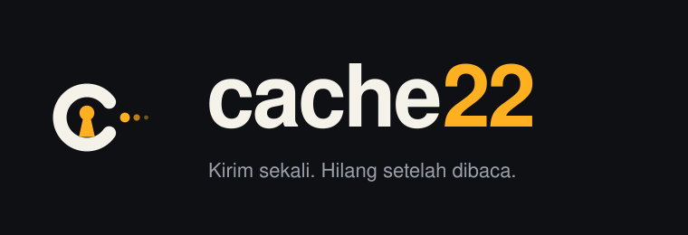

<p align="center">
  <picture>
    <source media="(prefers-color-scheme: dark)" srcset="assets/logo.svg">
    <source media="(prefers-color-scheme: light)" srcset="assets/logo-on-light.svg">
    
  </picture>
</p>

<p align="center">
  <a href="https://github.com/nekonaru/cache22/actions/workflows/ci.yml"></a>
  <a href="LICENSE"></a>
  
</p>

# Cache22

**Send once. Gone after reading.** / **Kirim sekali. Hilang setelah dibaca.**

Cache22 is a one-time secret sharing service. You paste text or a small file, get a single unique link, and the moment the recipient opens it, the data is permanently deleted from the server. Encryption happens in the browser (zero-knowledge): the key lives only in the URL fragment and the server stores ciphertext only.

`README.md` (English) · [`README.id.md`](README.id.md) (Indonesia)

---

## Why

Sending a password over chat means it lives forever in history, backups, and notifications. Cache22 makes the secret self-destructing instead:

- **Zero-knowledge** — encryption is client-side (AES-256-GCM via Web Crypto). The key sits in the URL fragment (`#…`), which browsers never send to the server.
- **Burn after reading** — consumption is atomic: once the secret is shown, it is gone. Two simultaneous readers cannot both succeed.
- **Preview-safe links** — chat apps that auto-open links see an HTML page only, never your secret (decryption requires the fragment **and** the user pressing the button).
- **Uniform failures** — “not found / already read / expired” are byte-identical `404 {"error":"not_found"}` responses, so IDs can’t be probed by status.
- **One static binary** — Go standard library only. `web/index.html` is embedded with `go:embed`.

## Features

| | |
| --- | --- |
| Create one-time text drops (≤ 64 KB) and file drops (≤ 2 MB) | ✅ |
| TTL: 10 min / 1 h / 24 h / 7 days | ✅ |
| Max opens: 1 (default) up to 10 | ✅ |
| Client-side AES-256-GCM, key in URL fragment | ✅ |
| Optional passphrase lock (PBKDF2-HMAC-SHA256, 600 000 iterations) | ✅ |
| Encrypted small files (name included in the envelope) | ✅ |
| Per-IP token-bucket rate limiting | ✅ |
| CLI: `deadrop` — pipe secrets straight from the terminal | ✅ |
| In-memory storage with atomic consume + expiry sweeper | ✅ |
| Bilingual UI (ID/EN, browser language detection), dark & light | ✅ |

## Quick start

### Run from source (Go ≥ 1.23)

```bash
git clone https://github.com/nekonaru/cache22.git
cd cache22
go run ./cmd/cache22            # listens on :8080
```

Open <http://localhost:8080> — paste a secret, get a link, open it once.

### Build the binaries

```bash
make build     # bin/cache22 and bin/deadrop
./bin/cache22 --version
```

### Docker

```bash
docker build -t cache22 .
docker run --rm -p 8080:8080 -e CACHE22_BASE_URL=https://secrets.example.com cache22
```

The image is `gcr.io/distroless/static-debian12:nonroot`; the binary runs as non-root.

## Using the CLI

```bash
echo "db-password: hunter2" | deadrop                 # prints the link
echo "token" | deadrop -ttl 10m -max-reads 2
deadrop -file ./credentials.json                      # up to 2 MB
deadrop get https://host/d/ID#KEY                     # read + burn
```

`deadrop get` prints text drops to stdout; file drops are saved to disk (`-o path` or the original encrypted filename) with `0600` permissions. Set `CACHE22_SERVER` to point at your instance, `CACHE22_PASSPHRASE` to avoid prompts.

The CLI encrypts with the exact same envelope format as the web UI — a link printed by `deadrop` opens in any browser, and vice-versa. The key is verified never to appear in server logs (see [Development](#development)).

## How it works

```
 sender's browser/CLI                    server                     recipient
 ┌──────────────────┐   ciphertext   ┌──────────────┐   page    ┌────────────────┐
 │ AES-256-GCM      │ ───────────▶   │ stores blob  │ ───────▶  │ clicks “Reveal”│
 │ key → fragment   │                │ (no key!)    │           │ key from #…    │
 └──────────────────┘                └──────────────┘           └───────┬────────┘
       link: https://host/d/ID#KEY          ▲                            │
                                            └──── POST /api/drops/ID/read ┘
                                                  (atomic consume-and-delete)
```

- `GET /d/{id}` always returns the same HTML page and never touches storage — chat-app link previews therefore can’t burn your secret.
- Only `POST /api/drops/{id}/read` consumes a drop, and it does so atomically (mutex-guarded read-modify-write), so exactly one of N concurrent readers wins.
- The fragment is stripped from the address bar with `history.replaceState` as soon as the page loads.
- If a passphrase is set, the link carries **no** key at all; the random data key is wrapped (PBKDF2-HMAC-SHA256 → AES-256-GCM) and stored server-side in `meta`. Share the passphrase over a separate channel.

### API

| Method & path | Description |
| --- | --- |
| `POST /api/drops` | Create a drop. Body: `{payload, ttl, max_reads?, kind, meta?}`. → `201 {id, url, expires_at}`. Errors: `400`, `413`, `429`, `503`. |
| `GET /d/{id}` | Recipient page. Always `200`, identical for every id. |
| `POST /api/drops/{id}/read` | Consume a drop. → `200 {payload, kind, meta}` or uniform `404 {"error":"not_found"}`. |
| `GET /healthz` | `200 ok` |

`payload` is base64url(`iv[12] ‖ AES-256-GCM ciphertext`) of a JSON envelope `{"v":1,"kind":"text|file","name"?,"data":base64url}`. `ttl` must be one of `10m, 1h, 24h, 7d`. `max_reads` defaults to `1`, max `10`. IDs are 128-bit `crypto/rand`, base64url (22 chars).

### Configuration

| Flag | Env | Default |
| --- | --- | --- |
| `-addr` | `CACHE22_ADDR` | `:8080` |
| `-base-url` | `CACHE22_BASE_URL` | `http://localhost:8080` |
| `-max-text-bytes` | `CACHE22_MAX_TEXT_BYTES` | `65536` |
| `-max-file-bytes` | `CACHE22_MAX_FILE_BYTES` | `2097152` |
| `-max-total-bytes` | `CACHE22_MAX_TOTAL_BYTES` | `67108864` |
| `-rate-per-min` | `CACHE22_RATE_PER_MIN` | `30` |
| `-burst` | `CACHE22_BURST` | `10` |
| `-trust-proxy` | `CACHE22_TRUST_PROXY` | `false` |

`-trust-proxy` (use only behind a trusted reverse proxy) controls whether `X-Forwarded-For` is honoured for rate limiting. Every response carries `Cache-Control: no-store`, `Referrer-Policy: no-referrer`, `X-Content-Type-Options: nosniff`, `X-Robots-Tag: noindex` and a strict `Content-Security-Policy` with a per-request nonce.

## Honest limitations

- Cache22 cannot stop the **recipient** from copying or photographing the secret after it is shown.
- If the full link (including `#…`) leaks **before** it is opened, whoever sees it can read the secret — that is what “a link is a capability” means. With a passphrase, the link alone is useless; without one, treat it like a password.
- MVP stores drops in memory with a global byte budget: **restart = all drops lost**. Persistent storage (bbolt) is on the roadmap.
- Encrypted-at-rest (payloads encrypted on the client and key only in the fragment) means the server operator cannot read contents — but traffic metadata (size, timing) is not hidden.

## Threat model (abridged)

| Threat | Mitigation |
| --- | --- |
| ID guessing | 128-bit IDs; uniform 404 body/status/headers; rate limiting |
| Link-preview bots burning drops | Consume only via `POST …/read` from the page; `GET` never mutates |
| Malicious/curious server, breach | Zero-knowledge client-side encryption; server sees ciphertext + opaque meta only |
| Double-spend race | Atomic read-and-delete under one mutex |
| Log/referrer leakage | Minimal logs (method, route template, status, duration); `no-referrer`; `no-store` |
| Oversized payload / abuse | Per-kind size caps + global memory budget; 503 when full; rate limits; max TTL 7 days |
| XSS on recipient page | Strict CSP with per-request nonce; secret rendered via `textContent` |
| Passphrase brute-force | PBKDF2-HMAC-SHA256, 600 000 iterations (Argon2 unavailable in Web Crypto — PBKDF2 is the standards-track fallback) |

## Development

```bash
make test    # go vet + go test -race ./...
make run     # dev server on :8080
```

Layout:

```
cmd/cache22/       server entrypoint
cmd/deadrop/       CLI
internal/config    flags + env, validated
internal/store     Store interface + in-memory impl (atomic Consume, Sweep)
internal/server    HTTP handlers, security headers, logging, rate limiting
internal/ratelimit token bucket
internal/crypt     CLI-side crypto (mirrors the browser implementation)
web/index.html     the single-page UI (embedded via go:embed)
assets/            logos, favicons (ink/signal/paper/slate)
```

Manual verification checklist:

1. `go test -race ./...` — includes a 100-goroutine test asserting exactly one reader wins.
2. Create a drop with DevTools open (Network tab). Reload the link, press **Reveal**, and confirm no request URL contains `#` and no id appears in server logs.
3. With the server log at `info`, confirm you see only `route="POST /api/drops/{id}/read"` — never the concrete id or payload.
4. Encrypt a file in the UI and decrypt it in the CLI (`deadrop get`), and vice-versa.
5. Check `curl -s -D - -o /dev/null http://localhost:8080/` for the security headers listed above.

## Roadmap

- Persistent storage via bbolt/BadgerDB (drop survives restart; Consume inside a single write transaction)
- Configurable max reads per drop (API already accepts `max_reads` 1–10)
- Opt-in webhook / Telegram “message was read” notification (with SSRF guards: private/loopback addresses refused)
- Optional public-demo rate shaping / lightweight CAPTCHA

## License

[MIT](LICENSE) © 2026 Niko (nekonaru)

---

**Cache22** — because your secrets should be as ephemeral as the link that carries them.
